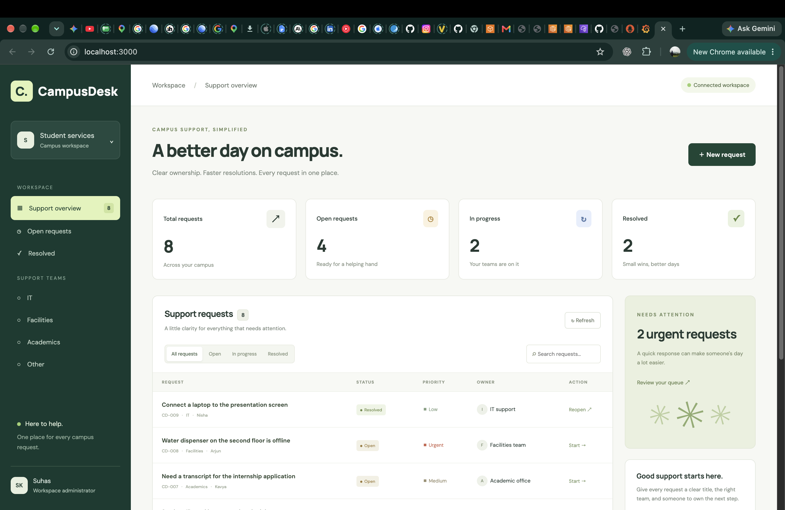
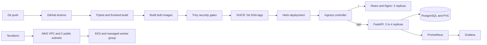

# CampusDesk — DevOps Capstone

**Suhas · 24BCS10261**

CampusDesk is a campus helpdesk for IT, facilities, and academic support. Students can raise a request, choose a team and priority, assign an owner, and follow the request from open to resolved. The dashboard includes search, status filters, request counts, and create, edit, resolve, reopen, and delete actions.

The application uses React, FastAPI, PostgreSQL, and Alembic. Docker runs the local stack; GitHub Actions tests, builds, scans, publishes, and deploys each release. Helm manages the Kubernetes application, while Prometheus and Grafana show its request traffic.



## Architecture



The application and monitoring demonstrations run on the laptop's Kind cluster. The hosted delivery job deploys the published images to a fresh Kind cluster on the GitHub runner. The AWS exercise separately provisions and verifies a real VPC, EKS cluster, and two workers in Mumbai, then destroys that infrastructure.

## Run locally

Requirements: Docker with Compose. For the other exercises, install Python 3.12+, Node.js 24, kubectl, Kind, Helm, Terraform, and the AWS CLI.

```bash
cp .env.example .env
# Choose DATABASE_PASSWORD in .env before starting.
docker compose up --build -d
python3 scripts/seed_demo.py
```

Open **http://localhost:3000**. Swagger is available at **http://localhost:8000/docs**. The seed script adds eight sample campus requests to an empty workspace and preserves existing data.

```bash
docker compose ps
curl http://localhost:8000/health
curl http://localhost:8000/ready
docker compose down
```

The PostgreSQL volume survives `docker compose down`. Removing the volume also removes the saved requests.

## Application and database

| Method | Endpoint | Purpose |
| --- | --- | --- |
| GET | `/health` | Application liveness |
| GET | `/ready` | Database readiness |
| GET | `/metrics` | Prometheus metrics |
| GET | `/api/tickets` | List, search, and filter requests |
| GET | `/api/tickets/stats` | Dashboard counts |
| GET | `/api/tickets/{id}` | Read one request |
| POST | `/api/tickets` | Create a request |
| PUT | `/api/tickets/{id}` | Update a request |
| DELETE | `/api/tickets/{id}` | Delete a request |

Alembic migration `0001` creates the `tickets` table. The backend acquires a PostgreSQL advisory lock before migrating, so multiple replicas can start together without racing the schema update. `/ready` checks the database connection; `/health` checks the application process.

[CRUD and PostgreSQL execution results](evidence/04-api-database.txt)

## Tests and containers

```bash
python3 -m venv .venv
source .venv/bin/activate
pip install -r backend/requirements-dev.txt
cd backend
pytest -v
```

All **16 tests pass**. They cover health, readiness, ticket creation, listing, reading, updating, deletion, search, status filtering, statistics, invalid inputs, missing records, metrics, and an empty workspace. Each test uses a fresh SQLite database through a dependency override; the PostgreSQL application database is untouched.

The backend container runs as UID **10001**. The frontend uses a Node build stage and an Nginx runtime stage, running as UID **101** on port 8080. Compose starts PostgreSQL first, waits for database readiness, then starts the backend and frontend.

[Test output](evidence/02-backend-tests.txt) · [Test screenshot](evidence/screenshots/11-pytest-results.png) · [Compose and non-root checks](evidence/03-compose-stack.txt) · [Compose screenshot](evidence/screenshots/12-compose-stack.png)

## CI/CD and security

Every push to `main` starts [CampusDesk CI and delivery](.github/workflows/ci-cd.yml):

1. Run pytest and build the React frontend.
2. Build both Docker images.
3. Scan both images with Trivy. HIGH or CRITICAL findings fail the job.
4. Publish the scanned images to GHCR using the full Git commit SHA.
5. Pull those images into a fresh Kubernetes cluster, install the Helm release, wait for healthy workloads, and check `/ready`.

[Successful hosted run](https://github.com/Suhassk205/taskboard-capstone/actions/runs/38953107445) · [Pipeline screenshot](evidence/screenshots/14-ci-success.png) · [Complete hosted logs](evidence/15-hosted-pipeline.log)

| Image | Package | Evidence |
| --- | --- | --- |
| Backend | [campusdesk-backend](https://github.com/Suhassk205/taskboard-capstone/pkgs/container/campusdesk-backend) | [SHA tags](evidence/screenshots/17-ghcr-backend.png) |
| Frontend | [campusdesk-frontend](https://github.com/Suhassk205/taskboard-capstone/pkgs/container/campusdesk-frontend) | [SHA tags](evidence/screenshots/18-ghcr-frontend.png) |

Trivy checked the Alpine operating-system packages and application dependencies inside both images, with the gate set to HIGH and CRITICAL severity. The recorded scans found zero vulnerabilities at those severities, allowing publication and deployment to proceed. This result describes the scanned image and vulnerability database at that time; it does not guarantee that future scans will stay clean.

[Backend scan output](evidence/16-trivy-backend.txt) · [Frontend scan output](evidence/17-trivy-frontend.txt) · [Backend scan screenshot](evidence/screenshots/15-trivy-backend.png) · [Frontend scan screenshot](evidence/screenshots/16-trivy-frontend.png)

## AWS infrastructure with Terraform

The Terraform lab created **15 resources** in `ap-south-1`: a VPC (`10.42.0.0/16`), two public subnets in separate availability zones, an Internet Gateway, public routing, IAM roles and policy attachments, an **EKS 1.35** cluster, and a managed worker group with **two `t3.small` nodes**. AWS reported both the cluster and worker group as ACTIVE.

The lab uses public worker subnets to keep the demonstration small. It has no NAT Gateway or managed database. Terraform state, saved plans, local inputs, credentials, and kubeconfig files are excluded from Git.

```bash
cd terraform
cp terraform.tfvars.example terraform.tfvars
terraform init
terraform fmt -check
terraform validate
terraform plan
terraform apply
aws eks update-kubeconfig --region ap-south-1 --name <cluster-name>
kubectl get nodes
terraform destroy
terraform state list
```

Use an authenticated AWS profile before running the cloud commands. The saved execution includes provisioning, verification, and cleanup. Session credentials expired during cleanup; rerunning destroy with automatic credential renewal removed the remaining resources. The final state and AWS queries confirm that the capstone infrastructure was removed.

[Initialization and plan](evidence/07-terraform-plan.txt) · [Apply](evidence/08-terraform-apply.txt) · [AWS verification](evidence/09-aws-verification.txt) · [Destroy and cleanup verification](evidence/10-terraform-destroy.txt)

[Plan screenshot](evidence/screenshots/22-terraform-plan.png) · [VPC Console](evidence/screenshots/21-aws-vpc-console.png) · [EKS Console](evidence/screenshots/20-aws-eks-console.png) · [Destroy screenshot](evidence/screenshots/23-terraform-destroy.png)

## Kubernetes, Helm, and Ingress

The `campusdesk` namespace contains two frontend replicas, at least two backend replicas, PostgreSQL, a PVC, ClusterIP Services, Ingress, and a backend HPA. Database credentials come from an existing Kubernetes Secret.

For the local image tags, build with Compose and load both images into your Kind cluster:

```bash
kind load docker-image campusdesk-backend:local campusdesk-frontend:local --name session13
kubectl apply -f k8s/namespace.yaml
kubectl -n campusdesk create secret generic campusdesk-db \
  --from-env-file=.env
helm upgrade --install campusdesk helm/campusdesk -n campusdesk \
  --set ingress.host=campusdesk.localhost --wait
kubectl -n campusdesk get pods,svc,ingress
helm list -n campusdesk
```

This laptop uses the existing Kind cluster `session13`. For another cluster, change the Kind name and kubectl context. An Ingress controller, default StorageClass, and Metrics Server must be available.

The Nginx Ingress controller routes `/` to the frontend Service and `/api` to the backend Service. A local port forward exposes that controller:

```bash
kubectl -n ingress-nginx port-forward service/ingress-nginx-controller 8088:80
```

Open **http://campusdesk.localhost:8088**. The HPA scales the backend between two and four replicas at a CPU target of 50%. The recorded API load test scaled it from **two to four** replicas; the load Job was removed afterward.

[Helm execution](evidence/06-helm-deployment.txt) · [Pods, Services, and Helm screenshot](evidence/screenshots/24-helm-pods-services.png) · [Application through Ingress](evidence/screenshots/25-ingress-application.png) · [Autoscaling results](evidence/13-hpa-scaling.txt) · [HPA screenshot](evidence/screenshots/33-hpa-scaling.png)

## Prometheus and Grafana

Prometheus discovers Running backend Pods in the `campusdesk` namespace and scrapes `/metrics` every five seconds. Grafana uses that Prometheus instance and loads [the CampusDesk dashboard](monitoring/campusdesk-dashboard.json), which shows total HTTP requests and request rate by endpoint.

The [Helm values](monitoring/) configure both tools. The lab uses the Prometheus Community `prometheus` chart and Grafana's `grafana` chart in namespace `monitoring`. Grafana's administrator password is supplied through `campusdesk-grafana-admin`; the local demonstration permits anonymous Viewer access.

```bash
python3 scripts/install_monitoring.py --context kind-session13
kubectl -n monitoring port-forward service/prometheus-server 9091:80
kubectl -n monitoring port-forward service/grafana 3001:80
kubectl -n campusdesk port-forward service/backend 8001:8000
curl http://localhost:8001/metrics
```

Prometheus is at **http://localhost:9091/targets** and Grafana at **http://localhost:3001/d/campusdesk**. The dashboard screenshots contain actual traffic from the API load exercise.

[Monitoring installation](evidence/11-monitoring-install.txt) · [Live target and query verification](evidence/12-ingress-and-monitoring.txt) · [Metrics screenshot](evidence/screenshots/32-backend-metrics.png) · [Prometheus targets UP](evidence/screenshots/30-prometheus-targets.png) · [Populated Grafana dashboard](evidence/screenshots/31-grafana-dashboard.png)

## Troubleshooting

The isolated `campusdesk-lab` exercise used a nonexistent image tag to demonstrate `ErrImagePull`/`ImagePullBackOff`, then corrected the image and verified rollout. A Service with the wrong selector had no endpoints; correcting the selector restored endpoints and an HTTP response. The first immediate connectivity check failed while the Service was converging; the repeated check after reconciliation succeeded. The exercise namespace was deleted afterward.

[Broken manifests](troubleshooting/) · [Diagnosis and recovery transcript](evidence/14-troubleshooting.txt) · [Recovery screenshot](evidence/screenshots/34-troubleshooting.png)

## Presentation and evidence

[Recorded delivery walkthrough](evidence/campusdesk-delivery-walkthrough.mp4) shows a dashboard change being committed and pushed, the hosted pipeline completing, and the exact SHA-tagged GHCR images being installed with Helm on the laptop. The final browser view displays the updated support-team description. [The delivery transcript](evidence/18-recorded-delivery.txt) records the image pulls, deployment, and verification.

[Presentation guide](docs/presentation-guide.md) covers the application, database, tests, containers, pipeline, security scan, registry, AWS infrastructure, Kubernetes, Helm, Ingress, HPA, monitoring, and troubleshooting in demonstration order.

| Module | Evidence |
| --- | --- |
| M1 — Application | [Running UI](evidence/screenshots/10-compose-application.png), [CRUD and PostgreSQL](evidence/04-api-database.txt) |
| M2 — Testing | [16 passing tests](evidence/screenshots/11-pytest-results.png), [JUnit report](evidence/backend-tests.xml) |
| M3 — Git | [Complete commit-history screenshot](evidence/screenshots/01-published-commit-history.png), [GitHub page](evidence/screenshots/04-github-complete-commit-history.png), [published records](evidence/01-published-commit-history.txt) |
| M4 — Docker | [Compose and non-root execution](evidence/03-compose-stack.txt), [terminal screenshot](evidence/screenshots/12-compose-stack.png) |
| M5 — CI/CD | [Successful pipeline](evidence/screenshots/14-ci-success.png), [backend](evidence/screenshots/17-ghcr-backend.png) and [frontend](evidence/screenshots/18-ghcr-frontend.png) packages |
| M6 — Security | [Backend scan](evidence/screenshots/15-trivy-backend.png), [frontend scan](evidence/screenshots/16-trivy-frontend.png), explanation above |
| M7 — Terraform | [Plan](evidence/screenshots/22-terraform-plan.png), [VPC](evidence/screenshots/21-aws-vpc-console.png), [EKS](evidence/screenshots/20-aws-eks-console.png), [destroy](evidence/screenshots/23-terraform-destroy.png) |
| M8 — Kubernetes | [Helm, Pods, and Services](evidence/screenshots/24-helm-pods-services.png), [Ingress browser view](evidence/screenshots/25-ingress-application.png) |
| M9 — Observability | [Metrics](evidence/screenshots/32-backend-metrics.png), [UP targets](evidence/screenshots/30-prometheus-targets.png), [Grafana](evidence/screenshots/31-grafana-dashboard.png) |
| M10 — Presentation | [Recorded walkthrough](evidence/campusdesk-delivery-walkthrough.mp4), [delivery transcript](evidence/18-recorded-delivery.txt), [presentation guide](docs/presentation-guide.md) |

CampusDesk runs without user authentication and is intended for a controlled classroom demonstration. The single PostgreSQL replica and local volume suit this lab; a production service would need authentication, TLS, backups, and a database availability plan.
